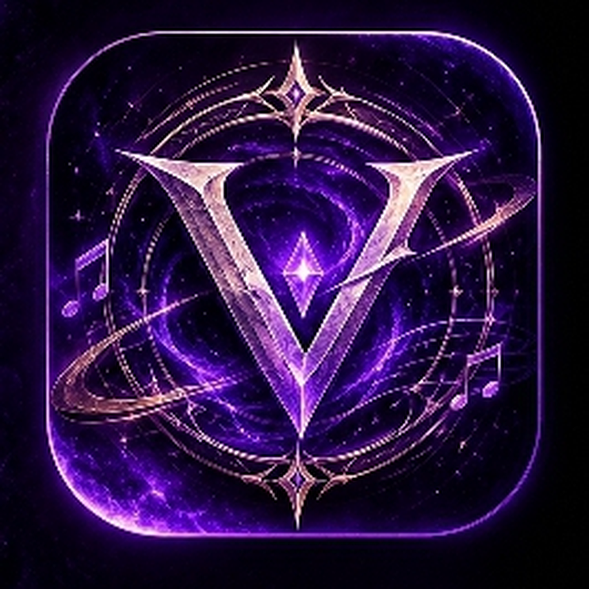

<table>
<tr>
<td width="130" align="center" valign="top">
  
<b>VoidTune</b> 
<i>Mjurran Arc</i>  

</td>
<td valign="top">

## VoidTune (Mjurran Arc)

**VoidTune** is an ultra-optimized, high-performance Android music player fork engineered for instant 1–2 second audio playback, zero UI stutter, and seamless Spotify playlist synchronization, wrapped in an AMOLED pure-black aesthetic with gothic typography and responsive glassmorphism interfaces.

---

### Upstream Lineage & Source Ownership
VoidTune is built upon and proudly acknowledges its upstream foundation: [**ArchiveTune**](https://github.com/rukamori/ArchiveTune), originally created and maintained by [**Rukamori**](https://github.com/rukamori). All original intellectual properties, foundations, and trademarks remain under the [**GNU General Public License v3.0 (GPL-3.0)**](LICENSE).

---

### Why Detached Fork & Reason for Enhancements
This standalone fork was created and actively refined by **Mjurran** to resolve critical usability bottlenecks encountered in daily listening:
* **Network Bottlenecks & Starvation:** Quadrupled OkHttp connection limits so background library sync never starves audio streaming.
* **Perpetual Playback Buffering:** Enforces a guest-patented stream engine that eliminates 403 BotGuard rejections and constant buffering while logged in.
* **Streamlined Spotify Integration:** Re-routed drawer login directly to effortless Spotify Connect integration, delivering instantaneous playback without account-locking or authorization headaches.
* **Artistic Rebranding & UI Polish:** Revamped with a vibrant galactic emblem, 45% faded grey charcoal glassmorphism modals, Gothic Unifraktur typography, and authentic QRIS support.

---

### Non-Destructive Code Modification Policy
> **Strict Transparency Rule:** No original upstream code is ever erased, deleted, or silently overwritten. All original code is kept intact inside comments with clear explanations of why it was commented out, followed by the improved VoidTune implementation right below it.

</td>
</tr>
</table>
